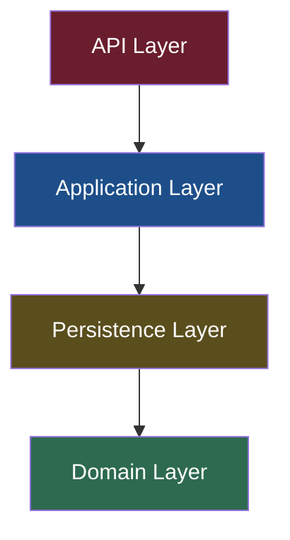
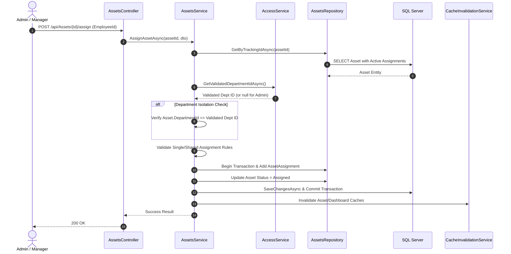
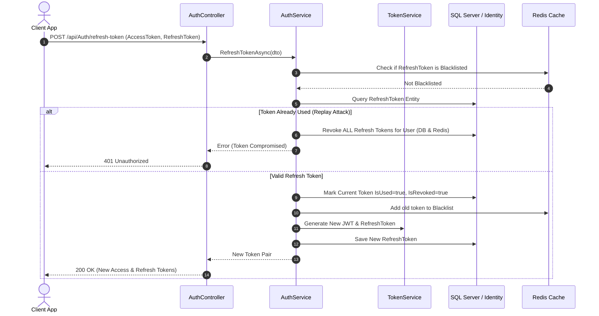
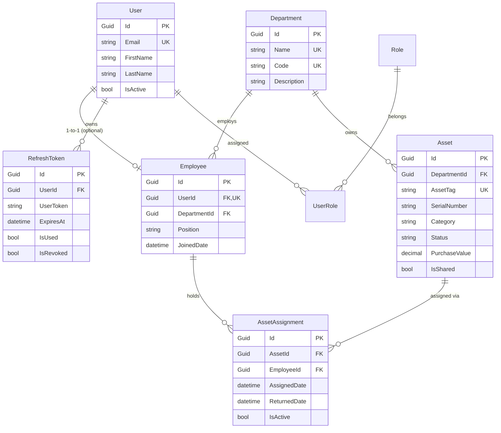

## Asset Management System

ASP.NET Core 10 · Onion Architecture · Clean Code Principles · SQL Server · Redis · JWT

A backend REST API for managing organisational assets, employees, departments, and asset assignments. Built using Onion Architecture and Clean Code principles, the system provides role-based access control, department-scoped authorization, secure JWT authentication with refresh token rotation, and Redis-backed dashboard caching.

It also supports asset lifecycle tracking, assignment history, departmental asset valuation, and dashboard analytics to help organisations maintain control over their IT assets.

## Table of Contents
1. [Project Overview](#1-project-overview)
2. [Quick Verbal Introduction (1–2 minutes)](#2-quick-verbal-introduction-12-minutes)
3. [Architecture & Code Organisation](#3-architecture--code-organisation)
4. [Detailed Business Logic](#4-detailed-business-logic)
   - 4.1 [Authentication & Token Management](#41-authentication--token-management)
   - 4.2 [User & Identity Management](#42-user--identity-management)
   - 4.3 [Department Management](#43-department-management)
   - 4.4 [Employee Management](#44-employee-management)
   - 4.5 [Asset Management](#45-asset-management)
   - 4.6 [Asset Assignment Management](#46-asset-assignment-management)
   - 4.7 [Dashboard & Reporting](#47-dashboard--reporting)
   - 4.8 [Profile Management](#48-profile-management)
5. [Business Rules Reference](#5-business-rules-reference)
6. [Main Workflows](#6-main-workflows)
7. [Data Model & Database Relationships](#7-data-model--database-relationships)
8. [Validation, Errors, Transactions & Auditing](#8-validation-errors-transactions--auditing)
9. [API Reference & Developer Setup](#9-api-reference--developer-setup)
10. [Source-Code Verification Table](#10-source-code-verification-table)
---

## 1. Project Overview

### What the System Does
The **Asset Management System** is a multi-tenant-style REST API designed for medium-to-large organisations to track physical equipment (laptops, monitors, mobile devices, printers, furniture) across departments, assign and unassign items to employees, track assignment histories, and generate aggregated asset valuation reports.

### The Business Problem It Solves
Organisations frequently suffer from lost hardware, unrecorded asset allocation, lack of departmental accountability, and inefficient reporting during audits. This system solves these challenges by:
- Enforcing **Department Isolation**: Managers are strictly bounded to their own department's assets and personnel.
- Maintaining **Complete Assignment History**: Keeping track of who held which asset, for what duration, and its return state.
- Providing **Real-time Analytics**: High-performance cached dashboard reporting aggregate asset values and category/status distributions.

### Roles & Responsibilities

| Role | Operational Scope | Core Capabilities |
|---|---|---|
| **Admin** | Global / System-wide | Full CRUD across all departments, users, employees, and assets. Handles employee/asset cross-department transfers, role promotions, user management, and views global analytics. |
| **Manager** | Department Scoped | Manages assets within their assigned department. Can assign/unassign assets in their department and edit basic department metadata. Cannot create new departments or transfer employees/assets across departments. Cannot list all employees via global API due to controller authorization.But can list all employees of their department. |
| **Employee** | Self Service | Read-only access to their own profile and currently/previously assigned assets. |
| **Client** | Self Registered User | Default role upon registration. Has an authentication account but no `Employee` record or department association. Must be promoted to `Employee` by an Admin. |

### Main Domain Entities & Relationships
- **User**: ASP.NET Core Identity entity representing authentication credentials and identity state.
- **Employee**: Organisational record linked 1-to-1 with a `User`. Belongs to exactly one `Department`.
- **Department**: Organisational unit containing employees and physical assets.
- **Asset**: A physical unit (identified by a unique `AssetTag` and optional `SerialNumber`) assigned to a `Department`. Can be flagged as `IsShared`.
- **AssetAssignment**: Junction entity recording the assignment of an `Asset` to an `Employee`, tracking `AssignedDate`, `ReturnedDate`, `IsActive` state, and notes.

---

## 2. Quick Verbal Introduction (1–2 minutes)

## 2. Quick Verbal Introduction (1–2 minutes)
> *"This project is an Enterprise Asset Management REST API built with ASP.NET Core (.NET 10), following **Onion Architecture and Clean Code principles**. It enables organisations to manage IT assets, departments, employees, and asset assignments while maintaining strict security and data integrity.*
> *The system is structured into Domain, Application, Persistence, and API layers. Onion Architecture keeps the core business logic independent of infrastructure concerns, while Clean Code principles promote separation of responsibilities, maintainability, and readable, testable code.*
>*Security is a key aspect of the system. Authentication uses JWT bearer tokens with refresh token rotation, while access control is enforced through role-based authorization and department isolation. Managers can access only the employees and assets within their assigned department, with these restrictions validated at the service layer using `AccessService`.*
>*For performance, Redis provides dashboard caching, supported by asynchronous background workers that refresh cached data. Explicit database transactions help maintain data consistency across related operations.*
>*Overall, the project demonstrates how architectural principles, security mechanisms, and performance optimisations can be combined to build a maintainable and secure backend system."*
---

## 3. Architecture & Code Organisation

### Project Structure & Layer Dependencies

```
Intership.slnx
├── API/                          ← Presentation Layer (Controllers, DI, Security, Filters)
├── Application/                  ← Business Logic (Services, Interfaces, DTOs, Validators, Mappings)
├── Domain/                       ← Core Domain (Entities, Enums, Repository Contracts)
└── Persistence/                  ← Infrastructure & Data Access (EF Core Context, Repositories, Migrations)
```



> **Note on Solution References**: In the actual `.csproj` configuration,`API.csproj` references `Application.csproj`, `Application.csproj` includes a direct project reference to `Persistence.csproj`, which references `Domain.csproj`. 

### Layer Responsibilities

1. **API Layer (`API`)**:
   - ASP.NET Core Web API project housing API Controllers, Swagger OpenAPI setup, JWT authentication handlers, rate limiters, and global exception filter attributes (`ApiExceptionFilterAttribute`).

2. **Application Layer (`Application`)**:
   - Contains application services (`AssetsService`, `EmployeeService`, `AuthService`, etc.), DTOs, Mapping profiles, FluentValidation rules, and service interfaces.

3. **Persistence Layer (`Persistence`)**:
   - Implements `DataContext` (EF Core DBContext inheriting `IdentityDbContext`), Entity configurations, Repository implementations, EF Core interceptors (`AuditExecuteUpdateInterceptor`), and Migrations.

4. **Domain Layer (`Domain`)**:
   - Contains pure entity definitions (`Asset`, `Employee`, `Department`, `AssetAssignment`, `RefreshToken`, `User`), custom enums (`AssetStatus`), and repository interfaces (`IAssetsRepository`, `IEmployeeRepository`, etc.).
   - Holds zero external framework dependencies.

### Dependency Injection Setup
Services are registered using layer-specific extension methods:
- `API.DependencyInjection.AddAPILayer(services, configuration)`: JWT Auth, Rate Limiter, Swagger, Controllers, Action Filters.
- `Application.DependencyInjection.AddApplicationLayer(services)`: Business services (Scoped), AutoMapper, FluentValidation, Background Queues/Services, Redis (`IDistributedCache`).
- `Persistence.DependencyInjection.AddPersistenceLayer(services, configuration)`: SQL Server `DataContext`, ASP.NET Core Identity settings (`MaxFailedAccessAttempts = 5`, `DefaultLockoutTimeSpan = 7 min`), Repository bindings, `AuditExecuteUpdateInterceptor`, Database Seeder.

### Security, Tokens & Authentication Flow
- **Token Format**: HMAC-SHA256 Signed JWTs containing `NameIdentifier` (User ID), `Email`, `Name`, `Jti`, and `Role` claims.
- **Access Token Expiry**: Configured to 20 minutes with `ClockSkew = TimeSpan.Zero` for precise expiration.
- **Refresh Token Strategy**: 64-byte random crypto-string stored in `RefreshTokens` DB table. Expiration set to 7 days.
- **Token Rotation & Replay Detection**: Re-using an already consumed (`IsUsed == true`) refresh token triggers an immediate security violation, invalidating **all** refresh tokens associated with that user account in DB and adding them to the Redis blacklist.
- **Instant Revocation**: Logout revokes the refresh token in SQL Server and immediately writes the token string to Redis with a 7-day TTL blacklist (`auth:revoked:{tokenValue}`).

### Transactions & Data Consistency
- Multi-table writes (such as creating an employee alongside an Identity user, or unassigning assets during employee department transfer) are executed inside an explicit `IDbContextTransaction` managed by `TransactionRepository`.
- Repositories stage entity modifications in EF Core change tracking. `CommitTransactionAsync` calls `SaveChangesAsync()` internally to write all changes in a single atomic database operation.

### Caching Architecture (Redis & Cache-Aside)
- High-frequency read queries (e.g., Dashboard summary statistics) query Redis via `IDistributedCache` using keys specified in `CacheKeys`.
- On cache miss, data is queried from SQL Server and written to Redis with a 5-minute TTL.
- When write operations occur (Create/Update/Delete/Assign), `CacheInvalidationService` evicts relevant keys and enqueues a background job in `DashboardWarmupQueue` to asynchronously re-populate the cache.
- **Resilience**: `RedisCacheService` wraps Redis calls in try/catch blocks; if Redis is down, it catches the exception, logs a warning, and returns `default`, cleanly falling back to database queries without failing client requests.

---

## 4. Detailed Business Logic

### 4.1 Authentication & Token Management
- **Self-Registration**: Registers a new `User` with password hashing via ASP.NET Core Identity (`AuthService.RegisterAsync`). The user is unconditionally assigned the `Client` role.
- **Login**: Verifies credentials, checks lockouts (5 failed attempts trigger a 7-minute account lockout), generates a 20-minute JWT and a 7-day Refresh Token, and enqueues a dashboard cache warmup for the user's department context.
- **Refresh Token**: Validates refresh token existence, expiration, and revocation status. Replay of a used token revokes all user tokens. Valid requests generate a brand-new access token and refresh token pair (token rotation).

### 4.2 User & Identity Management
- **Role Hierarchy**: `Admin` > `Manager` > `Employee` > `Client`.
- **Promotion Workflow**: `EmployeeService.PromoteUserToEmployeeAsync` allows an Admin to convert a `Client` user to an `Employee` by creating an `Employee` entity linked to a target `DepartmentId` and assigning the `Employee` role.
- **Account Deactivation**: `User.IsActive` flag exists and is checked during refresh token requests (`AuthService.RefreshTokenAsync`).

### 4.3 Department Management
- **Creation**: Restricted to `Admin` (`HttpPost` in `DepartmentsController`). Service layer checks `AccessService` to reject Manager attempts. Enforces uniqueness on `Name` and `Code`.
- **Manager Modifications**: Managers can update their own department's `Name` and `Description` via `PUT /api/Departments/my-department`. Managers cannot alter the department `Code` or delete departments.
- **Deletion Rules**: A department cannot be deleted if it contains active `Employee` records or `Asset` records (`Error.Conflict`).

### 4.4 Employee Management
- **Department Binding**: Every employee is associated with a specific department, ensuring clear organisational ownership and accountability.
- **Department Isolation**: Both Admins and Managers can access the general employee listing endpoint (`GET /api/Employees/GetAll-Employees`) with pagination and optional search, as well as retrieve individual employee details through `GET /api/Employees/GetEmployee-ById`. Department-level access restrictions for Managers are enforced in the application service layer through `IAccessService`, ensuring they can access only employees within their assigned department, while Admins retain global access.
- **Department Transfer**: Only Admins can transfer employees to another department through `PATCH /api/Employees/Update-Department/{id}`. The system automatically closes active asset assignments held by the transferred employee to prevent cross-department asset ownership violations.
- **Employee Deletion**: Only Admins can delete employees. Before deletion, the system closes all active asset assignments and returns non-shared assets to `InStock`, then deletes the employee and linked user records within a single transaction.
- **Administrative Operations**: Creating employees, updating employee records, managing department assignments, performing bulk operations, promoting Clients to Employees, and changing user roles are restricted to Admins through role-based authorization.

### 4.5 Asset Management
- **Asset Identification**: Assets require a globally unique `AssetTag` and optional `SerialNumber`.
- **Manager Scoped Creation**: When a Manager creates an asset (`POST /api/Assets/CreateBy-Manager`), the system ignores any supplied `DepartmentId` in the request body and enforces the Manager's own department ID retrieved from DB.
- **Status Lifecycle**:
  - `InStock`: Available for assignment.
  - `Assigned`: Currently assigned to one (or more, if shared) employees.
  - `InRepair` / `Retired`: Manual administrative statuses.
- **Deletion/Transfer Restrictions**: Assets currently in `Assigned` status cannot be deleted or transferred to another department without first being unassigned.

### 4.6 Asset Assignment Management
- **Single vs Shared Assets**:
  - **Non-Shared Asset (`IsShared == false`)**: Can only have 1 active assignment at any given time. Attempting to assign an already assigned non-shared asset returns `Error.Conflict`.
  - **Shared Asset (`IsShared == true`)**: Can be assigned to multiple employees concurrently. The application service prevents assigning the same shared asset to the same employee twice (`AssetsService.AssignAssetAsync`).
- **Department Constraint**: An employee and an asset MUST belong to the same department to perform an assignment.
- **Unassignment Logic**: Unassigning sets `IsActive = false` and populates `ReturnedDate`. If no other active assignments remain on the asset, its status automatically reverts from `Assigned` to `InStock`.

### 4.7 Dashboard & Reporting
- Aggregates system metrics: `TotalPurchaseValue`, `ValueByDepartment`, `StatusBreakdown`, `AssetsByCategory`, and `AgeDistribution`.
- **Admin Dashboard**: `GET /api/Dashboard/admin/full` returns global cross-department aggregates or filtered single-department stats.
- **Manager Dashboard**: `GET /api/Dashboard/manager/full` is always scoped to the manager's department ID derived from their database employee profile.
- **Live Aggregations**: On cache HIT, `ValueByDepartment` is still queried live from database in `DashboardService.GetDashboardInternalAsync`.

### 4.8 Profile Management
- Allows logged-in users to view/update personal information (Name, Gender, Phone), change passwords, and request/confirm email changes with security stamp invalidation.

---

## 5. Business Rules Reference

| Rule ID | Name | Description / Logic | Code Location | Status |
|---|---|---|---|---|
| **BR-01** | Client Default Role | All self-registered users are assigned the `Client` role. | `AuthService.RegisterAsync` | ✅ Verified |
| **BR-02** | 1-to-1 User-Employee Link | A `User` can be linked to at most one `Employee` profile. | `EmployeeConfiguration` (`UserId` unique index) | ✅ Verified |
| **BR-03** | Mandatory Department Binding | Every `Employee` MUST belong to a valid `Department`. | `EmployeeConfiguration` | ✅ Verified |
| **BR-04** | Mandatory Asset Department | Every `Asset` MUST belong to a valid `Department`. | `AssetConfiguration` | ✅ Verified |
| **BR-05** | Department Scoped Access | Managers can only view/modify assets in their department. Controller blocks global employee list for Managers. | `AccessService.GetValidatedDepartmentIdAsync` & `EmployeesController` | ⚠️ Partially Verified |
| **BR-06** | Single Assignment for Non-Shared | A non-shared asset (`IsShared=false`) cannot have >1 active assignment. | `AssetsService.AssignAssetAsync` | ✅ Verified |
| **BR-07** | Unique Assignment for Shared | A shared asset cannot be assigned to the same employee multiple times concurrently. | Enforced in `AssetsService.AssignAssetAsync` | ✅ Verified (App Level) |
| **BR-08** | Department Match on Assign | Asset and Employee must belong to the exact same department during assignment. | `DepartmentsService.IsEmployeeInDepartmentAsync` | ✅ Verified |
| **BR-09** | Block Assigned Asset Delete/Transfer | Assigned assets cannot be deleted or transferred between departments. | `AssetsService.DeleteAsync` & `UpdateDepartmentAsync` | ✅ Verified |
| **BR-10** | Non-Empty Department Protection | Departments containing employees or assets cannot be deleted. | `DepartmentService.DeleteAsync` | ✅ Verified |
| **BR-11** | Department Name Uniqueness | Department names must be globally unique. | `DepartmentConfiguration` (`.IsUnique()`) | ✅ Verified |
| **BR-12** | Department Code Uniqueness | Non-null department codes must be globally unique. | `DepartmentConfiguration` (`.IsUnique().HasFilter(...)`) | ✅ Verified |
| **BR-13** | Asset Tag Uniqueness | `AssetTag` must be globally unique. | `AssetConfiguration` (`.IsUnique()`) | ✅ Verified |
| **BR-14** | Serial Number Uniqueness | `SerialNumber` has a filtered index (`[SerialNumber] IS NOT NULL`). | `AssetConfiguration` (non-unique index) | ⚠️ Filtered Non-Unique |
| **BR-15** | Manager Department Creation Block | Managers are forbidden from creating new departments. | `DepartmentService.CreateAsync` & `DepartmentsController` | ✅ Verified |
| **BR-16** | Replay Detection Revocation | Presenting an already used refresh token revokes all user refresh tokens in DB & Redis. | `AuthService.RefreshTokenAsync` | ✅ Verified |
| **BR-17** | Account Lockout | 5 consecutive failed login attempts lock the account for 7 minutes. | `Persistence.DependencyInjection` | ✅ Verified |
| **BR-18** | Auto-Unassign on Employee Transfer | Transferring an employee automatically terminates all their active assignments. | `EmployeeService.UpdateDepartmentAsync` | ✅ Verified |
| **BR-19** | Auto-Unassign on Employee Deletion | Deleting an employee terminates all their active assignments. | `EmployeeService.DeleteAsync` | ✅ Verified |
| **BR-20** | InRepair / Retired Status Logic | Automated transitions into/out of `InRepair` or `Retired` are not implemented. | N/A | ⚠️ Manual Only |
| BR-21 | Denormalised Counts Sync | Department.AssetCount and EmployeeCount are automatically synchronized using SQL Server triggers on Assets and Employees table changes, ensuring the stored counts remain consistent with the underlying records. | Department entity, SQL Server triggers | ✅ Synchronized via database triggers |

---

## 6. Main Workflows

### Sequence Diagram 1: Asset Assignment Flow



### Sequence Diagram 2: Authentication & Token Refresh Flow



---

## 7. Data Model & Database Relationships

### Entity-Relationship Diagram



### Database Indexes & Schema Constraints

| Table   | Column / Expression | Index Type | Schema Definition |
|---      |---                  |---         |---                |
| `Users` | `Email` | Unique | `ASP.NET Identity` Default |
| `Employees` | `Email` | Unique | `builder.HasIndex(e => e.Email).IsUnique()` |
| `Employees` | `UserId` | Unique Filtered | `builder.HasIndex(e => e.UserId).IsUnique().HasFilter("[UserId] IS NOT NULL")` |
| `Departments` | `Name` | Unique | `builder.HasIndex(d => d.Name).IsUnique()` |
| `Departments` | `Code` | Unique Filtered | `builder.HasIndex(d => d.Code).IsUnique().HasFilter("[Code] IS NOT NULL")` |
| `Assets` | `AssetTag` | Unique | `builder.HasIndex(a => a.AssetTag).IsUnique()` |
| `Assets` | `SerialNumber` | Non-Unique Filtered | `builder.HasIndex(a => a.SerialNumber).HasFilter("[SerialNumber] IS NOT NULL")` |
| `AssetAssignments` | `(AssetId, EmployeeId)` | Non-Unique Filtered | `builder.HasIndex(aa => new { aa.AssetId, aa.EmployeeId }).HasFilter("[IsActive] = 1")` |

---

## 8. Validation, Errors, Transactions & Auditing

### Request Validation
- Handled via **FluentValidation** rules registered in the Application layer.
- Incoming request DTOs are validated prior to service execution.

### Error Handling & `ErrorOr` Mapping
- Application services return `ErrorOr<T>` results instead of throwing exceptions for expected domain failures.
- `BaseApiController.HandleResult` converts domain errors into standard HTTP responses:
  - `ErrorType.Validation` → `400 Bad Request`
  - `ErrorType.Unauthorized` → `401 Unauthorized`
  - `ErrorType.Forbidden` → `403 Forbidden`
  - `ErrorType.NotFound` → `404 Not Found`
  - `ErrorType.Conflict` → `409 Conflict`
  - `ErrorType.Failure` → `422 Unprocessable Entity`

### Audit Trail Automation
1. **Change Tracker Interception**: In `DataContext.SaveChangesAsync`, entities implementing `IAuditableEntity` automatically set:
   - On Insert: `CreatedAt = UtcNow`, `CreatedBy = CurrentUserId`.
   - On Update: `LastModifiedAt = UtcNow`, `LastModifiedBy = CurrentUserId`.
2. **Bulk Update Interception**: `AuditExecuteUpdateInterceptor` (`Persistence/Extensions/AuditExecuteUpdateInterceptor.cs`) intercepts EF Core `ExecuteUpdateAsync` calls and dynamically appends audit updates (`LastModifiedAt`, `LastModifiedBy`) to bulk LINQ expressions.

---

## 9. API Reference & Developer Setup

### Quick Setup Commands

1. **Clone & Environment Setup**:
   Copy `.env.example` to `.env` and configure your database connection string and JWT secret.
   ```bash
   cp .env.example .env
   ```
   
2. **Database Migration & Seeding**:
   Run Entity Framework Core migrations to initialize SQL Server tables and default roles (`Admin`, `Manager`, `Employee`, `Client`).
   ```bash
   dotnet ef database update --project Persistence --startup-project API
   ```

3. **Run Application**:
   ```bash
   dotnet run --project API
   ```

---

## 10. Source-Code Verification Table

| Claim / Mechanism in README | Source File & Location | Verification Status | Verification Finding & Notes |
|---|---|---|---|
| **Onion Architecture References** | `Application.csproj`, `Persistence.csproj`, `API.csproj` | **Partially Verified**
 | `Application` should reference `Domain`;`Persistence` should reference `Application` and `Domain`; 
 `API` should reference `Application` and may reference `Persistence` for Dependency Injection registration. 
 Dependencies should point inward toward the core layers. Actual project references must be verified against the `.csproj` files. |
| **Manager Department Isolation** | `AccessService.cs` (`GetValidatedDepartmentIdAsync`) & `AssetsService.cs` | **Verified** | `AccessService` queries `_employeeRepository` to fetch the Manager's `DepartmentId` directly from DB. Applied across `AssetsService` methods. |
| **Manager Employee Listing Route** | `EmployeesController.cs` (`GetAll-Employees`) | **Discrepancy Noted** | `EmployeeService.GetEmployeesPagedAsync` has manager department filtering logic, but `EmployeesController` places `[Authorize(Roles = "Admin")]` on `GetEmployees`, blocking Managers at controller level. |
| **JWT ClockSkew & Lifetime** | `API/DependencyInjection.cs` & `TokenService.cs` | **Verified** | `ClockSkew = TimeSpan.Zero` is configured in `TokenValidationParameters`. Token expiry generated for 20 mins. |
| **Refresh Token Rotation & Replay Detection** | `AuthService.cs` (`RefreshTokenAsync`) | **Verified** | If `IsUsed == true`, all tokens for that user are revoked in SQL Server and added to Redis blacklist with 7-day TTL. Valid tokens rotate properly. |
| **Logout Redis Blacklist** | `AuthService.cs` (`LogoutAsync`) | **Verified** | Sets token `IsRevoked = true` in DB and writes `auth:revoked:{token}` to Redis with a 7-day TTL. |
| **Redis Cache Fallback** | `RedisCacheService.cs` (`GetAsync`, `SetAsync`) | **Verified** | Catches `Exception`, logs warning/error, and returns `default` (Get) or proceeds cleanly without throwing (Set), allowing DB fallback. |
| **Transaction Boundary & Commit** | `TransactionRepository.cs` (`CommitTransactionAsync`) | **Verified** | Calls `await _context.SaveChangesAsync(cancellationToken)` before committing `IDbContextTransaction`. |
| **Bulk Update Audit Interception** | `AuditExecuteUpdateInterceptor.cs` | **Verified** | Implements `IQueryExpressionInterceptor`, intercepting `ExecuteUpdate`/`ExecuteUpdateAsync` to append `LastModifiedAt` and `LastModifiedBy`. |
| **AssetTag Unique Index** | `AssetConfiguration.cs` | **Verified** | `builder.HasIndex(a => a.AssetTag).IsUnique()` is present. |
| **SerialNumber Index** | `AssetConfiguration.cs` | **Correction Applied** | `builder.HasIndex(a => a.SerialNumber).HasFilter("[SerialNumber] IS NOT NULL")` is defined WITHOUT `.IsUnique()`. Index is non-unique filtered. |
| **AssetAssignment Compound Index** | `AssetAssignmentConfiguration.cs` | **Correction Applied** | `builder.HasIndex(aa => new { aa.AssetId, aa.EmployeeId }).HasFilter("[IsActive] = 1")` is defined WITHOUT `.IsUnique()`. Active assignment uniqueness is enforced at application level (`AssetsService`). |